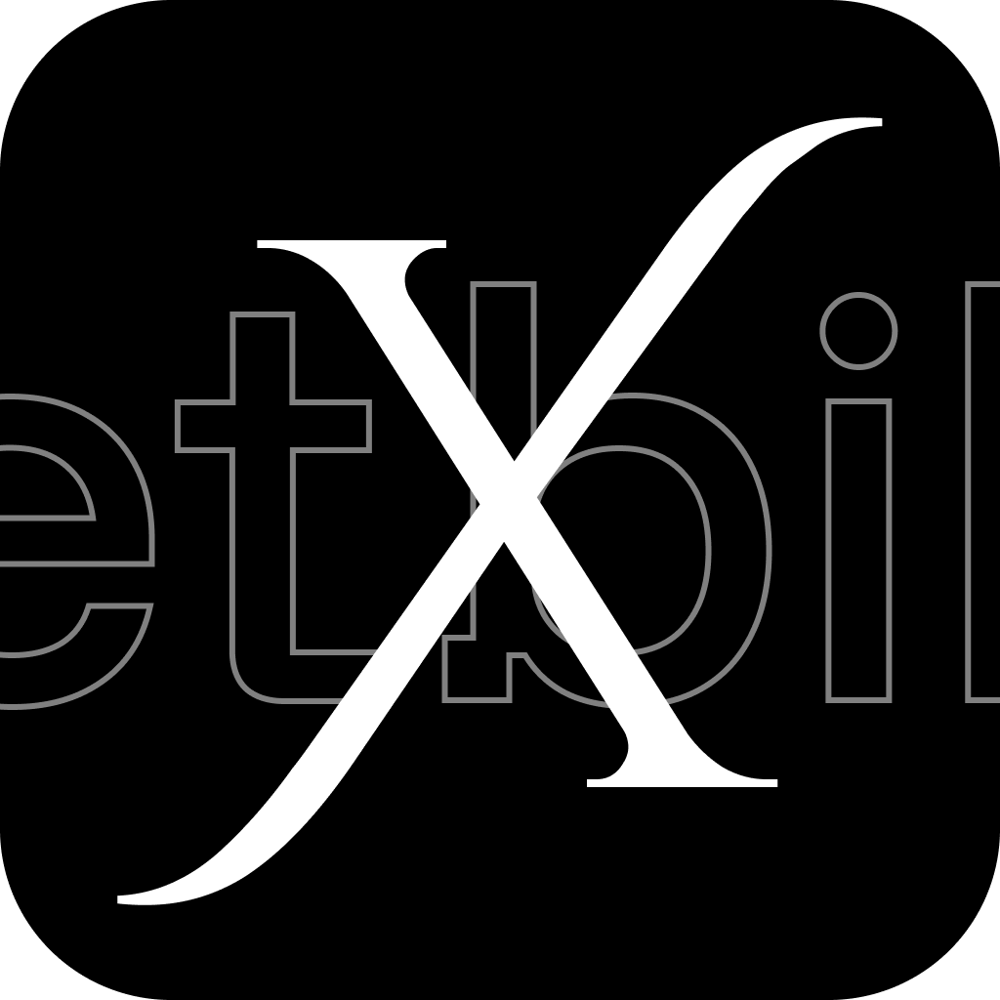

<p align="center">
  <picture>
    <source media="(prefers-color-scheme: dark)" srcset="public/bilet-x-dark-icon-v1.png">
    <source media="(prefers-color-scheme: light)" srcset="public/bilet-x-light-icon-v1.png">
    
  </picture>
</p>

<h1 align="center">Bilet-X</h1>

<p align="center">
  <strong>Your smart, always-on-top dynamic desktop companion.</strong><br>
  <em>One hotkey away. Zero distractions. 100% private.</em>
</p>

<p align="center">
  <a href="#download--installation"></a>
  <a href="#privacy-first-your-data-stays-with-you"></a>
  <a href="../../releases"></a>
  <a href="#for-developers--self-builders"></a>
</p>

---

## Why Bilet-X?

Tired of opening heavy browser tabs and juggling window clutter just to jot down a quick thought, glance at your next meeting, or check an incoming email? 

**Bilet-X** acts like a **smart dynamic island** for your desktop. It docks quietly on the edge of your screen, floats over your apps when you need it, and tucks away the instant you don't. Press a single global hotkey (`Ctrl + Shift + K` or `⌘ + Shift + K`), handle your quick tasks, and slide right back into your flow.

Best of all? **It never phones home.** Your notes, tasks, and accounts remain strictly on your own device.

---

## Everyday Superpowers

| Feature | How it helps your day |
|---|---|
| **Instant Scratchpad** | Quickly capture thoughts, code snippets, or meeting notes without losing your current window. Autosaves instantly to local storage. |
| **Quick Tasks** | Keep your daily to-do checklist right in view. Check off items as you finish them without opening bulky project management software. |
| **Unified Inbox** | Peek at new messages and notifications from **Gmail**, **Outlook**, **Slack**, and **WhatsApp** in one unified feed. |
| **Glanceable Calendar** | See your upcoming schedule and meetings at a glance so you never miss an event. |
| **Smart Clipboard History** | Easily recall recently copied snippets and paste them back into your work with a click. |
| **Pomodoro & Focus Timer** | Lock in with 25-minute focus intervals and timely break reminders directly on your screen border. |
| **Hydration Reminder** | Subtle reminders to drink water and maintain healthy habits during long work sessions. |
| **Spotify Quick Controls** | See what's playing and control your music without switching away from your active app. |
| **Bilet AI Companion** | Ask quick questions, summarize text, or draft replies directly from your floating widget. |

---

## Designed to Fit Your Screen & Style

- **Dock Anywhere:** Pin Bilet-X to the top, bottom, left, or right edge—or dock it in any corner of your screen.
- **Orientation Modes:** Switch effortlessly between **Horizontal Island** and **Vertical Bar** layouts depending on your display setup.
- **Auto-Hide & Discreet Mode:** Keep your screen pristine; set it to auto-hide when you focus on full-screen work.
- **Multi-Monitor Friendly:** Remembers your exact preferred screen and position, even if you disconnect or reconnect displays.
- **Themes That Match Your Mood:** Seamless toggle between sleek **Dark Mode** and clean **Light Mode**.

---

## Get Started in 60 Seconds

1. **Download & Launch:** Grab the installer for your operating system from the [Releases page](../../releases) and run it.
2. **Summon the Widget:** Press your global hotkey (default: **`Ctrl + Shift + K`** on Windows/Linux or **`⌘ + Shift + K`** on macOS).
3. **Personalize Your Dock:** Click the **Settings** icon to pick your dock edge, theme (dark/light), or customize your hotkey.
4. **Connect Your Tools:** Head over to the **Inbox** tab and click **Connect** on any service (Gmail, Slack, etc.). Your browser will open the provider's official login page, and you're set!

---

## Essential Keyboard Shortcuts

| Shortcut | Action |
|---|---|
| `Ctrl + Shift + K` *(or `⌘ + Shift + K`)* | **Toggle Bilet-X** (Show / Hide widget anywhere) |
| `Esc` | Close active popout / dismiss widget |
| `Tab` / `Shift + Tab` | Navigate between widget modules and inputs |
| *Customizable* | Change the summon hotkey anytime in **Settings → General** |

---

## Supported Integrations

Bilet-X connects directly to each provider using official OAuth authentication. **No third-party proxy server ever touches your data or credentials.**

| Provider | Supported Capabilities |
|---|---|
| **Gmail** | Read emails, mark as read, and view unread threads in your unified inbox. |
| **Outlook** | View incoming emails and quick updates side-by-side. |
| **Slack** | Read channel mentions and direct messages without opening the heavy Slack client. |
| **WhatsApp** | View recent conversations and messages. |
| **Google Calendar** | Read-only agenda view of upcoming meetings and day events. |
| **GitHub** | Track notifications, PR review requests, and issue mentions. |
| **Jira** | Stay on top of assigned tickets and project sprint updates. |

> [!NOTE]
> You can disconnect any service at any time from **Settings → Connected Services**. Disconnecting immediately and permanently removes all saved tokens from your local machine.

---

## Privacy First: Your Data Stays With You

Unlike web-based productivity dashboards, **Bilet-X has no cloud backend, no account sign-up, and zero analytics or telemetry.**

- **100% Local Storage:** All notes, to-dos, and cached items are stored in a local SQLite database directly on your drive.
- **Direct Authentication:** OAuth logins happen directly between your browser and the provider. Tokens are encrypted and saved locally.
- **Full Offline Capability:** Scratchpad, task lists, pomodoro timer, clipboard, and water tracker work completely offline.

### Local Storage Directories

If you ever want to back up or wipe your data manually:

- **Windows:** `%APPDATA%\com.bilet.x.app\`
- **macOS:** `~/Library/Application Support/com.bilet.x.app/`
- **Linux:** `~/.local/share/com.bilet.x.app/`

---

## Download & Installation

Download pre-built binaries for your platform from the **[Releases](../../releases)** tab:

| Platform | Download Package |
|---|---|
| **Windows 10 / 11** | `bilet-x_<version>_x64-setup.exe` (NSIS) or `.msi` |
| **macOS** (Apple Silicon & Intel) | `bilet-x_<version>_universal.dmg` |
| **Linux (Ubuntu / Debian)** | `bilet-x_<version>_amd64.deb` |
| **Linux (Any Distro)** | `bilet-x_<version>_amd64.AppImage` |

---

## For Developers & Self-Builders

Want to contribute, tweak features, or build from source? Bilet-X is built with modern, high-performance web and native tech:

- **Shell & System Hooks:** [Tauri v2](https://v2.tauri.app/) (Rust)
- **Frontend Framework:** [Angular 21](https://angular.dev/) + [Tailwind CSS](https://tailwindcss.com/)
- **Embedded Database:** SQLite via `rusqlite`
- **Icons:** [Lucide Angular](https://lucide.dev/)

### Building Locally

**Prerequisites:** Node.js 20+, Rust stable, and OS build tools (see [Tauri Prerequisites](https://v2.tauri.app/start/prerequisites/)).

```bash
# 1. Clone the repository
git clone https://github.com/Habeeb-Rahman-CA/bilet-x.git
cd bilet-x

# 2. Install dependencies
npm install

# 3. Start development mode with hot reload
npm run tauri:dev

# 4. Build native release package
npm run tauri:build
```

---

## Feedback & Community

Have an idea for a new integration? Spotted an issue? 

- **Suggest a Feature or Report a Bug:** Open an issue on our [GitHub Issues](../../issues) tracker.
- **Support the Project:** If Bilet-X helps boost your day-to-day productivity, give the repository a star!

---

<p align="center">
  Crafted for focused, distraction-free productivity.
</p>
